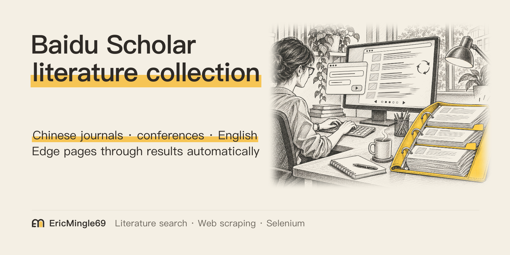

<picture>
  <source media="(prefers-color-scheme: dark)" srcset="readme-assets/cover-en-dark.png">
  
</picture>

<p align="center">
  <a href="介绍证书/使用指南（必看）.pdf">User guide</a> ·
  <a href="https://github.com/nickchen121/cyd-selected-journal">Original project</a> ·
  <a href="介绍证书/LICENSE">License text</a> ·
  <a href="https://github.com/Ming-Sir-69">Author</a>
</p>

<p align="center">
  <a href="介绍证书/README.md"></a>
  
  
  
  
</p>

<p align="center">
  <a href="README.md">简体中文</a> · <b>English</b>
</p>

# Edge literature retrieval: Baidu Scholar collection and journal metadata grouping

This project is a Windows desktop tool prototype. A Tkinter interface accepts search conditions, Selenium drives Microsoft Edge through Baidu Scholar results, and Requests reads article and journal pages. Records are grouped into Chinese journals, conferences, and English journals. For English journals, the tool attempts to add CiteScore, journal partition, and review-period fields, then writes grouped results to JSON text as processing proceeds.

## Features

- **Combined search conditions**: comma-separated exact terms are treated as terms that must all occur; the “at least one term” input joins terms with OR. Searches can target titles or full text and set a starting year. The defaults are title search and 2021.
- **Result traversal**: Selenium reads Baidu Scholar result pages, while Requests follows article links and extracts journal names.
- **Record grouping**: records are grouped by journal name into Chinese journals, conferences, and English journals, with counts for each group and for all records.
- **Additional English-journal fields**: journals not assigned to the first two groups are looked up on LetPub. CiteScore, partition, and review-period values are written only when the corresponding fields are returned.
- **Intermediate output**: the result file is rewritten after each recognizable record, so an early stop can leave a partial result that has already been saved.

## Quick start

The current entry point targets Windows. The bundled driver is a Windows x86-64 executable, and the “open result” action also uses Windows-only `os.startfile`. Python with Tkinter, Microsoft Edge, and an `msedgedriver.exe` whose major version matches Edge are required; Selenium documents the version correspondence<sup>[[2]](#references)</sup>.

From the repository root, run:

```bat
py -m pip install requests selenium
py 主程序.py
```

The interface reads the driver from `资源/驱动/msedgedriver.exe` and writes results to `搜索结果/` by default. To use another driver, enter its containing folder in the interface rather than the executable's full path.

The repository has no dependency manifest or lockfile. The command above installs current versions and does not reproduce a fixed environment. The complete online workflow was not run during this review.

## Usage

1. Fill either the exact-term input or the “at least one term” input. If both are filled, only the former is used.
2. Enter `0` for title search or `1` for full-text search, and set a starting year if needed.
3. Check the driver and result folders, then start the run. Keep the Edge window opened by the program available while it runs.
4. Inspect `result_hour_minute_second.txt` in the result folder. Its contents are JSON although the extension remains `.txt`.
5. The formatting button only opens a third-party JSON formatting website; it does not convert results locally. Before pasting records into that site, check whether they are suitable for external transmission.

The included [user guide](介绍证书/使用指南（必看）.pdf) retains the original interface and operating screenshots. Parts of it were written for earlier Chrome/Chromedriver versions, whereas the current code entry uses Edge/msedgedriver. These browser setups are not interchangeable.

## Design and principles

Tkinter is Python's standard interface to Tcl/Tk<sup>[[1]](#references)</sup>. `主程序.py` creates the interface, `界面元素/按钮处理.py` prepares keywords and paths, `功能/爬虫.py` performs web access and grouping, and Requests handles HTTP requests<sup>[[3]](#references)</sup>.

The processing path is:

```text
search conditions → Baidu Scholar pages → article pages and journal names → Chinese / conference / English routing
                                                                           └→ LetPub fields (English only)
                                                                           └→ grouped counts and JSON text output
```

Web extraction relies on fixed XPath expressions and regular expressions. Output files contain titles, links, journal names, and available external journal fields. They do not contain article full text, and the tool performs no bibliometric analysis.

## Limitations

- The interface passes a fixed page-count value into the crawler's second positional argument, which the current function signature defines as an additional search term. This argument mismatch is recorded here; code behavior was not changed in this review.
- Changes to Baidu Scholar or LetPub markup, access restrictions, or network conditions can cause early termination, missing fields, or errors. No automated tests cover these cases.
- Records are routed by whether a journal name contains Chinese characters or the string `Conference`; this is not complete publication-type identification. External fields reflect page values at retrieval time rather than a journal's current state.
- Retrieval runs inside an interface callback, so the interface may stop responding during a run. Output is saved by rewriting the whole file, and the last written state needs inspection after abnormal termination.
- Python, Requests, and Selenium versions are not pinned. `功能/test.py` is a separate legacy OpenAI API experiment, is not connected to retrieval, and is not a runnable test suite.
- The original materials include statements such as “no commercial use” alongside an Apache License 2.0 text. Their respective scopes have not been reconciled. This page does not reinterpret or expand those permissions.

## Development

Run the static syntax check from the repository root:

```sh
python3 -m compileall -q 主程序.py 功能 界面元素
```

The repository has no `AGENTS.md`, contributing guide, continuous integration, release workflow, or versioned releases. `主程序.beat/` contains earlier monolithic scripts. `资源/驱动/` contains a Windows driver and separate third-party license files. Check the sources and notices before modifying or redistributing these materials.

## Acknowledgements

- The original implementation and operating materials come from [cyd-selected-journal](https://github.com/nickchen121/cyd-selected-journal). This repository retains the original source files and notices.
- The interface, browser automation, and HTTP requests use Tkinter, Selenium, and Requests respectively<sup>[[1]](#references)[[2]](#references)[[3]](#references)</sup>.
- Search and journal fields come from Baidu Scholar, article-link pages, and LetPub. Their content and services remain subject to their own terms.
- The cover illustration was generated with an image-generation model and processed by this project.

## References

1. Python Software Foundation. *Python 3 documentation: tkinter — Python interface to Tcl/Tk*. <https://docs.python.org/3/library/tkinter.html>
2. Selenium Project. *Edge specific functionality: browser and driver major versions*. <https://www.selenium.dev/documentation/webdriver/browsers/edge/>
3. Requests Developers. *Requests documentation: Quickstart and Advanced Usage*. <https://requests.readthedocs.io/en/latest/>

## Related work

These works provide research context for web collection and structured extraction. Their inclusion does not imply that this repository implements their methods.

1. Chakrabarti, S., van den Berg, M., & Dom, B. (1999). Focused crawling: a new approach to topic-specific Web resource discovery. *Computer Networks*, 31(11–16), 1623–1640. <https://doi.org/10.1016/S1389-1286(99)00052-3>. Topic-specific web discovery relates to this project's restricted-topic searches; the project does not implement the paper's focused-crawling learning algorithm.
2. Laender, A. H. F., Ribeiro-Neto, B. A., da Silva, A. S., & Teixeira, J. S. (2002). A brief survey of web data extraction tools. *ACM SIGMOD Record*, 31(2), 84–93. <https://doi.org/10.1145/565117.565137>. This survey of web data extraction tools relates to the project's extraction of bibliographic fields from result pages.

## Repository structure

| Path | Contents |
|---|---|
| `主程序.py` | Tkinter graphical-interface entry point |
| `界面元素/` | Interface, button handling, and style configuration |
| `功能/爬虫.py` | Baidu Scholar traversal, journal-field retrieval, grouping, and output |
| `功能/文件处理.py` | Result-opening helper not connected to the current interface |
| `功能/test.py` | Separate legacy OpenAI API experiment, not a test suite |
| `主程序.beat/` | Earlier monolithic scripts |
| `介绍证书/` | Original project notes, user guide, and Apache 2.0 text |
| `资源/` | Style configuration, Windows Edge driver, and third-party licenses |
| `readme-assets/` | README cover and signature assets |

---

Maintained by <picture><source media="(prefers-color-scheme: dark)" srcset="readme-assets/em-logo-dark.svg"></picture> <b>EricMingle69</b> · <a href="https://github.com/Ming-Sir-69">Ming-Sir-69</a><br>
Existing code, materials, and third-party drivers retain their [original notices](介绍证书/README.md) and license texts. This page grants no new or expanded permissions.
