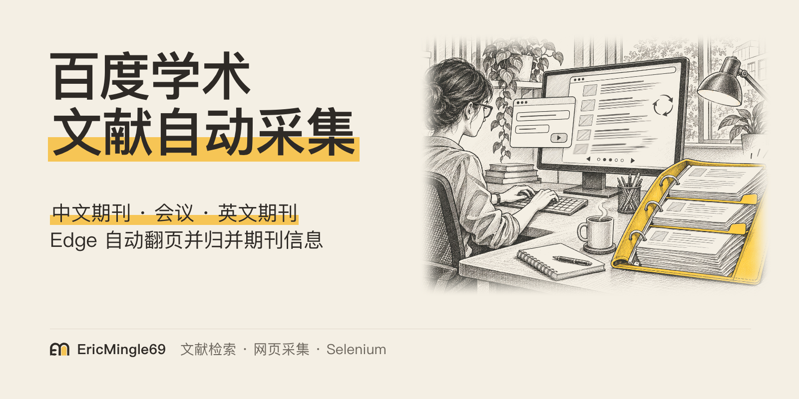

<picture>
  <source media="(prefers-color-scheme: dark)" srcset="readme-assets/cover-zh-dark.png">
  
</picture>

<p align="center">
  <a href="介绍证书/使用指南（必看）.pdf">使用指南</a> ·
  <a href="https://github.com/nickchen121/cyd-selected-journal">原始项目</a> ·
  <a href="介绍证书/LICENSE">许可文本</a> ·
  <a href="https://github.com/Ming-Sir-69">作者主页</a>
</p>

<p align="center">
  <a href="介绍证书/README.md"></a>
  
  
  
  
</p>

<p align="center">
  <b>简体中文</b> · <a href="README.en.md">English</a>
</p>

# Edge 文献检索工具：百度学术结果采集与期刊信息归并

本项目是一个 Windows 桌面工具原型：以 Tkinter 接收检索条件，用 Selenium 驱动 Microsoft Edge 遍历百度学术结果，再用 Requests 读取文献与期刊页面。程序将记录分为中文期刊、会议和英文期刊三组；对英文期刊尝试补充 CiteScore、分区和审稿周期，并把分组结果持续写入 JSON 文本。

## 主要功能

- **组合检索条件**：精确检索词以逗号分隔后按“同时包含”处理；“至少一个检索词”按“或”处理。可选择标题或全文检索，并设置起始年份，默认检索标题且起始年份为 2021。
- **遍历检索结果**：Selenium 按页读取百度学术结果，Requests 读取文献链接指向的页面并提取期刊名称。
- **归并文献记录**：按期刊名称分组，区分中文期刊、会议和英文期刊，同时维护各组数量与总数量。
- **补充英文期刊字段**：对未归入前两类的期刊查询 LetPub；仅在页面返回对应字段时写入 CiteScore、分区和审稿周期。
- **保留中间结果**：每处理一条可识别记录就重写结果文件，提前停止时仍可能保留已写入的部分结果。

## 快速开始

当前入口面向 Windows：附带驱动是 Windows x86-64 可执行文件，“打开结果”功能还调用 Windows 的 `os.startfile`。需要 Python（含 Tkinter）、Microsoft Edge，以及与 Edge 主版本匹配的 `msedgedriver.exe`；驱动版本对应关系见 Selenium 文档<sup>[[2]](#参考文献)</sup>。

在仓库根目录运行：

```bat
py -m pip install requests selenium
py 主程序.py
```

界面默认从 `资源/驱动/msedgedriver.exe` 读取驱动，并把结果写入 `搜索结果/`。如改用其他驱动，需在界面中填写其所在文件夹，而不是可执行文件的完整路径。

仓库没有依赖版本清单或锁文件。上述命令会安装当前版本，不构成固定环境复现；完整联网流程尚未在本轮核查中运行。

## 用法

1. 在“包含精确检索词”与“包含至少一个检索词”中填写一类条件；同时填写时，程序只使用前者。
2. 将检索位置填为 `0`（标题）或 `1`（全文），并按需填写起始年份。
3. 确认驱动文件夹和结果文件夹，点击运行。运行期间保持由程序打开的 Edge 窗口可用。
4. 在结果文件夹查看 `result_时_分_秒.txt`。文件内容是 JSON，扩展名仍为 `.txt`。
5. “结构化”按钮只打开第三方 JSON 格式化网站，不在本地转换结果；向该网站粘贴内容前需自行检查文献记录是否适合外传。

随仓库收录的[使用指南](介绍证书/使用指南（必看）.pdf)保留了原始界面和操作截图。该指南部分内容为早期 Chrome/Chromedriver 版本编写，当前代码入口使用的是 Edge/msedgedriver，两者不能直接混用。

## 设计与原理

Tkinter 是 Python 的标准 Tcl/Tk 图形界面接口<sup>[[1]](#参考文献)</sup>。`主程序.py` 创建界面，`界面元素/按钮处理.py` 整理关键词和路径，`功能/爬虫.py` 执行网页访问与分组，Requests 负责 HTTP 请求<sup>[[3]](#参考文献)</sup>。

处理链路为：

```text
检索条件 → 百度学术分页 → 文献页面与期刊名称 → 中文 / 会议 / 英文分流
                                               └→ LetPub 字段补充（仅英文）
                                               └→ 分组计数与 JSON 文本写入
```

网页定位依赖固定 XPath 和正则表达式。结果文件保存标题、链接、期刊名称及可获得的外部期刊字段，不保存论文全文，也不执行文献计量分析。

## 局限

- 当前界面把固定页数值传入检索函数的第二个位置参数；该位置在当前函数签名中表示附加检索词。界面到检索请求的参数对应存在错位，本轮只作记录，未改代码行为。
- 百度学术或 LetPub 的页面结构、访问限制和网络状态变化都可能导致提前结束、字段缺失或异常。程序没有针对这些情况的自动化测试。
- 三类记录按期刊名称是否含中文、是否含 `Conference` 分流；这不是完整的出版物类型识别。外部字段只反映抓取时页面返回值，不代表期刊当前状态。
- 检索运行位于界面回调中，运行期间界面可能停止响应。结果通过整文件重写保存，进程异常终止时最后写入状态仍需检查。
- 仓库未固定 Python、Requests 或 Selenium 版本。`功能/test.py` 是独立的旧版 OpenAI 接口试验，未接入检索流程，也不是可运行测试套件。
- 原始资料含“禁止商用”等声明，同时收录 Apache License 2.0 文本；各文本的适用范围未得到统一确认。本仓库页不重新解释或扩大授权。

## 开发

静态语法检查可在仓库根目录运行：

```sh
python3 -m compileall -q 主程序.py 功能 界面元素
```

仓库没有 `AGENTS.md`、贡献指南、持续集成、发布工作流或版本发布记录。`主程序.beat/` 保存早期单体脚本，`资源/驱动/` 保存 Windows 驱动及其独立许可文件；修改或再分发这些内容前需分别核查来源与声明。

## 致谢

- 原始实现与操作资料来自 [cyd-selected-journal](https://github.com/nickchen121/cyd-selected-journal)，本仓库保留原有来源文件和声明。
- 图形界面、浏览器自动化与 HTTP 请求分别使用 Tkinter、Selenium 和 Requests<sup>[[1]](#参考文献)[[2]](#参考文献)[[3]](#参考文献)</sup>。
- 检索与期刊字段来自百度学术、文献链接页面和 LetPub；这些内容及服务沿用各自条款。
- 封面插画由图像生成模型生成，经本项目处理。

## 参考文献

1. Python Software Foundation. *Python 3 documentation: tkinter — Python interface to Tcl/Tk*. <https://docs.python.org/3/library/tkinter.html>
2. Selenium Project. *Edge specific functionality: browser and driver major versions*. <https://www.selenium.dev/documentation/webdriver/browsers/edge/>
3. Requests Developers. *Requests documentation: Quickstart and Advanced Usage*. <https://requests.readthedocs.io/en/latest/>

## 相关研究

以下文献用于说明网页采集与结构化抽取的研究脉络，不表示本仓库依据这些文献实现。

1. Chakrabarti, S., van den Berg, M., & Dom, B. (1999). Focused crawling: a new approach to topic-specific Web resource discovery. *Computer Networks*, 31(11–16), 1623–1640. <https://doi.org/10.1016/S1389-1286(99)00052-3>。面向主题的网页发现对应本项目的限定主题检索；本项目没有实现该文的聚焦爬行学习算法。
2. Laender, A. H. F., Ribeiro-Neto, B. A., da Silva, A. S., & Teixeira, J. S. (2002). A brief survey of web data extraction tools. *ACM SIGMOD Record*, 31(2), 84–93. <https://doi.org/10.1145/565117.565137>。网页结构化抽取工具的综述对应本项目从结果页提取文献字段的机制。

## 仓库结构

| 位置 | 内容 |
|---|---|
| `主程序.py` | Tkinter 图形界面入口 |
| `界面元素/` | 界面、按钮处理与样式配置代码 |
| `功能/爬虫.py` | 百度学术遍历、期刊字段抓取、分组与结果写入 |
| `功能/文件处理.py` | 未接入当前界面的结果打开辅助代码 |
| `功能/test.py` | 独立的旧版 OpenAI 接口试验，不属于测试套件 |
| `主程序.beat/` | 早期单体脚本 |
| `介绍证书/` | 原项目说明、使用指南与 Apache 2.0 文本 |
| `资源/` | 风格配置、Windows Edge 驱动及第三方许可 |
| `readme-assets/` | README 封面与署名资源 |

---

文档维护：<picture><source media="(prefers-color-scheme: dark)" srcset="readme-assets/em-logo-dark.svg"></picture> <b>EricMingle69</b> · <a href="https://github.com/Ming-Sir-69">Ming-Sir-69</a><br>
既有代码、资料与第三方驱动分别沿用其[原有声明](介绍证书/README.md)和许可文本；本页不新增或扩大授权。
